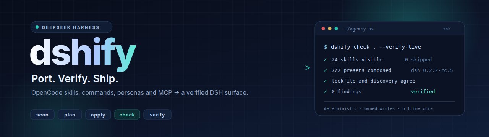

# @eatosin/dshify-plugin

[](https://www.npmjs.com/package/@eatosin/dshify-plugin)
[](https://github.com/Eatosin/dshify/actions/workflows/ci.yml)
[](https://github.com/Eatosin/dshify/blob/main/LICENSE)

<p align="center">
  
</p>

> **Released.** `@eatosin/dshify-plugin@0.5.0` is live. It requires engine `^0.3.0` and tracks live composition verification (`verifyLive`) alongside `--delegation`, model routes, and preset prefixes. Compatibility: DSH `0.2.2-rc.1` and later. The Web panel can apply after an explicit confirmation.

DeepSeek Harness (DSH) plugin for [dshify](https://github.com/Eatosin/dshify). It ports an OpenCode repository to a DSH surface from inside a session.

## Install

In DSH, open the plugin installation page and enter the package name:

```text
@eatosin/dshify-plugin
```

Compatibility: DSH `0.2.2-rc.1` and later. The plugin requires Node.js 22.12 or later. It depends on `@eatosin/dshify@^0.3.0`, which contains the migration engine and the offline core.

### Troubleshooting: `spawn pnpm ENOENT`

The DSH plugin manager uses pnpm for lookup and install. If the Add plugin dialog fails with `spawn pnpm ENOENT`, install pnpm once, then retry:

```bash
npm install -g pnpm
```

## What it adds

The plugin adds one model-facing tool, one human command, and a Web panel with a confirmed apply.

| Name | Purpose |
|---|---|
| `migrate_harness` tool | Run `scan`, `plan`, `apply`, or `check` on a repository. |
| `/migrate` command | The same actions from the composer. Default action is `plan`. |
| Web panel | Settings → Plugins → **dshify migration**: repository path, destination, presets, **Scan** / **Plan** / **Check**, and **Apply** behind a confirmation card. Shows the summary, findings, artifacts and raw JSON. |

The tool input:

| Field | Type | Default | Notes |
|---|---|---|---|
| `action` | `scan` \| `plan` \| `apply` \| `check` | required | `apply` writes files. |
| `path` | string | `.` | Repository path. Relative paths use the session working directory. |
| `dest` | string | `.dsh` | Destination tree inside the repository. |
| `presets` | boolean | `false` | Also emit the `.dsh/harness/` preset bundle. |
| `delegation` | boolean | `false` | Emit a parent preset with model-routed child tools. Requires `presets`. |
| `presetPrefix` | string | none | Namespace for generated preset ids, for example `agency-`. |
| `modelMap` | object | none | Persona id to `{ provider, model, tool }`. Requires `delegation`. |
| `extraPlugins` | string[] | none | Bundle-local plugin specifiers relative to `cordis.patch.yml`. |
| `verifyLive` | boolean | `false` | On `check`, compose the installed bundle with the local `dsh` in a temporary `DSH_HOME`. |
| `force` | boolean | `false` | Replace human-edited artifacts during `apply`. |

`apply` writes only inside `dest` and the lockfile. It never deletes user files. If a file is not owned by dshify, `apply` reports a conflict.

## Web panel

Open **Settings → Plugins → dshify migration**. The panel runs `scan`, `plan` and `check` against a repository path (empty means the current workspace). It shows the summary, findings, artifact list, and raw JSON.

**Apply** opens a confirmation card first. It writes the destination and the lockfile, reports conflicts, and keeps them. The route requires `confirm: true` and rejects an unconfirmed `apply` with `403`. The panel does not expose `force`; use the tool or `/migrate apply` for that.

## Command

```text
/migrate plan                 # show the conversion plan
/migrate apply . --presets    # write the surface and the preset bundle
/migrate apply . --presets --delegation --preset-prefix agency-  # parent preset with routes
/migrate check                # verify files, lockfile and DSH discovery
/migrate check --verify-live  # also compose the installed bundle with the local dsh
```

## Security

- The migration engine is offline. `scan`, `plan`, and `check` never make network calls. `--verify-live` composes the bundle locally in a temporary `DSH_HOME`; it installs nothing and still makes no network request.
- `apply` writes files and needs confirmation in the panel. Use a test branch first.
- No secret value from the source repository enters the tool output.

## License

MIT. See [LICENSE](LICENSE).
